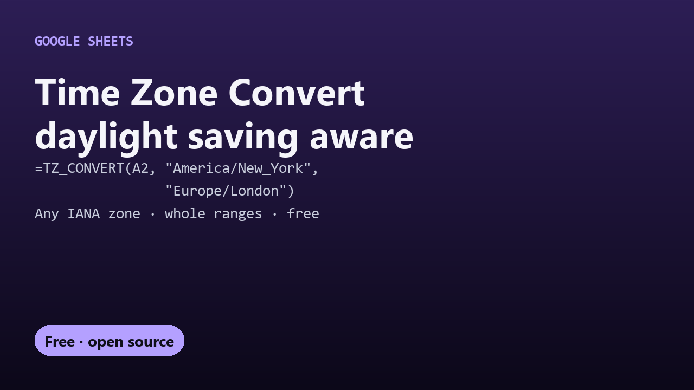

# Free Time Zone Convert for Google Sheets

Convert date-times between time zones in Google Sheets with daylight saving time handled correctly. One free custom formula, `TZ_CONVERT`.

## Guides

- [How to convert time zones in Google Sheets, with daylight saving](convert-time-zones-google-sheets.html)

## Get it

The script and full instructions are on GitHub: [DecodedXR/sheets-timezone-convert](https://github.com/DecodedXR/sheets-timezone-convert). It's MIT licensed and free.
